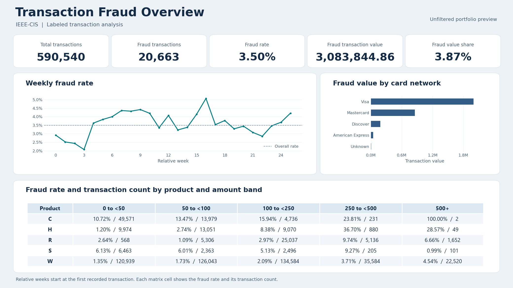

# IEEE-CIS Transaction Fraud Analytics

An interactive Power BI report and reproducible Python analysis of **590,540 labeled transactions**. The report compares fraud frequency and transaction value across products, card networks, devices, amount bands, and relative weeks.



## Key findings

| Metric | Result |
| --- | ---: |
| Transactions analyzed | 590,540 |
| Transactions labeled as fraud | 20,663 |
| Fraud rate | 3.50% |
| Fraudulent transaction value | 3,083,844.86 |
| Fraudulent share of total transaction value | 3.87% |

- **Discover had the highest fraud rate among named card networks**, at 7.73% across 6,651 transactions. **Visa accounted for the largest share of fraudulent transaction value**, at 64.78%.
- **Product C recorded 8,008 frauds across 68,519 transactions**, a fraud rate of 11.69%.
- **Relative week 16 had the highest observed overall fraud rate**, at 5.07% across 21,078 transactions.

## Data and methodology

The project uses the labeled training data from the [IEEE-CIS Fraud Detection competition on Kaggle](https://www.kaggle.com/competitions/ieee-fraud-detection/data). The Python notebook validates transaction IDs and fraud labels, left-joins identity data by transaction ID, and produces a transaction-level CSV. The Power BI model uses DAX to calculate fraud rates and value shares from filtered totals.

Fraud rate is the share of transactions labeled as fraud. Fraud value share is the share of total transaction amount associated with fraud labels. Amounts use the dataset's original units. Missing card network and device values are shown as **Unknown**. Relative week 0 begins at the first recorded transaction. Use the matrix's transaction counts to interpret rates based on small groups.

## Run locally

Requires Python with Jupyter and Power BI Desktop on Windows.

1. Download `train_transaction.csv` and `train_identity.csv` from Kaggle and place both files in a `Dataset/` folder at the repository root.
2. Install the Python dependencies, then launch Jupyter from the repository root.

   ```bash
   python -m pip install -r requirements.txt
   python -m jupyter notebook
   ```

3. Open [the analysis notebook](Python/01_data_audit.ipynb) and run all cells to generate `Dataset/fraud_analysis_powerbi.csv`.
4. Open `PowerBI/Fraud Analytics.pbip`. In Power BI Desktop, open **Transform data**, choose **Edit parameters**, and set **FraudCsvPath** to the full path of the generated CSV. Apply the changes and refresh. Keep the `.Report` and `.SemanticModel` folders next to the `.pbip` file.

To verify the interactive report, select product **C** and device **mobile**. The cards should show **29,169 transactions**, **3,834 frauds**, and a **13.14% fraud rate**.

## Project files

| Path | Contents |
| --- | --- |
| [Python/01_data_audit.ipynb](Python/01_data_audit.ipynb) | Data checks, feature preparation, exploratory analysis, and CSV export |
| [PowerBI/](PowerBI/) | Editable Power BI report and semantic model |
| [dashboard-preview.png](dashboard-preview.png) | Static preview of the unfiltered analysis |
| [requirements.txt](requirements.txt) | Python dependencies |
